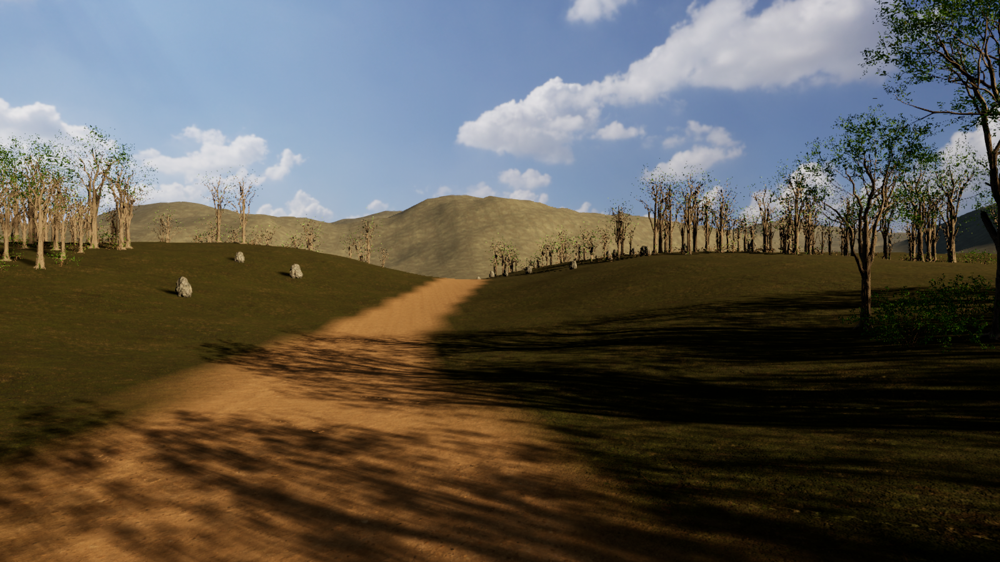

# Week 11: procedural environments

Open a prepared Unreal project, inspect small PCG examples, then adapt one reusable graph to dress a trail. Desert, forest and snow examples share the placement system and vary their assets and materials.

## Open the project

1. Install **Unreal Engine 5.7** through Epic Games Launcher. This kit was tested in **5.7.4 on Windows**.
2. Clone this private repository, or extract the complete student ZIP to a short local path such as `C:\UnrealProjects\Week11-PCG`.
3. Open [Week11PCGTrail.uproject](Unreal/Week11PCGTrail/Week11PCGTrail.uproject). Let first-use shaders finish compiling.

The required assets and native graphs are included. No Fab download, asset migration, Python installation, C++ build, custom plugin installation or setup script is needed. The project enables the bundled Unreal PCG and editor Python plugins itself. Unreal and access to this private repository are prerequisites, not bundled software.

The project opens **PCG_Museum**. Its PCG examples generate automatically. Use **Tools > Week 11 PCG Museum** to focus a station, open its graph, or switch to the full trail and building examples.

For updates, close Unreal, keep your own edits committed or backed up, then run `git pull --ff-only`. Do your experiments in a duplicate map or on a personal branch.

## Choose a route

- **Spline examples:** use the museum menu to open `Spline_Examples`. One native graph places posts along an open spline and scatters shrubs inside a closed region. Select its PCG actor and Generate after editing the input curves.
- **Museum:** seven focused demonstrations below. Predict the result before changing one control.
- **Optional practice:** [Student-Lab.md](Student-Lab.md), a short parameter experiment in `Trail_Student`.
- **Variations:** maps under `Content/Trail/Variations/Maps` compare density, seed and spline layout using shared assets and graphs.
- **Building stretch:** open `Building_Examples` from the museum menu. [Building guide](Unreal/Week11PCGTrail/BUILDING_EXAMPLE.md) explains dimensions, internal-face cancellation and kit compatibility.
- **Lecture:** open the included [PowerPoint](Slides/Week11-PCG.pptx) or offline [slide reader](Slides/index.html). No Spaces access is required.
- **Examples to review:** [current Unreal captures](Instructor/Demo-Gallery.html), including the building, museum, seed comparisons and readable node views.

## Museum stations

| Station | One question | Change to try |
| --- | --- | --- |
| 01 Candidates | Where do positions come from? | Increase grid cell size from 300 to 600 cm. |
| 02 Transform variation | Can appearance change without changing count? | Change the Transform Points seed. |
| 03 Closed spline exclusion | Which candidates lie inside a region? | Move the orange closed exclusion input. |
| 04 Projection and suitability | Which ground is acceptable? | Raise the normal-Z cutoff from 0.975 to 0.995. |
| 05 Shared rules, asset profiles | Can two presets reuse one graph? | Swap a compatible mesh/weight table. |
| 06 Bounds and overlap | Which candidates should compete? | Increase the competition bounds from 140 to 300 cm. |
| 07 Building dependencies | Which parts depend on the dimensions? | Change Cells from `(2,2,2)` to `(2,2,3)`. |

Select a station's PCG actor, open its graph with the menu, inspect the numbered stage, and regenerate after editing. Reset your edit before comparing another case. Station 05 uses a short teaching graph; the full trail uses the larger shared biome graph. Station 07 is optional architectural depth.

## Optional Blueprint extension

The lecture includes an attributed custom-node reference that selects a fixed number of points. The student project uses the bundled native graphs. No course Blueprint is required.

## What is included

Twenty-one example maps, native editable graphs and graph instances, weighted mesh tables, photoreal assets, textured rolling terrain, a reserved trail, sky and presentation lighting. The terrain is an authored static-mesh heightfield with collision, rather than an Unreal Landscape.

The student texture sources are capped at 2048 pixels; distant foliage impostors are capped at 1024. The project is approximately 569 MiB before local caches. Opening Unreal generates additional cache data. Those files are excluded from Git.

This is an **editor demonstration**. Bounds-based point pruning is not full mesh collision. A clear visual trail does not prove navigation or runtime generation works. Building outputs currently use rectangular footprints and a flat platform roof. Houdini is an optional instructor topic and is not required by this project.

## If something looks wrong

- Wait for shaders and texture streaming before judging the scene.
- Use the museum menu to reopen the desired example. Select its PCG component and click **Generate** if you have manually cleared its outputs.
- Check that a modified graph instance still points to the supplied shared graph, and that its asset table matches the reservation size.
- Restore the full checkout or re-extract the complete ZIP if assets are missing. Avoid merging this kit into an unrelated project with conflicting package paths.
- If Unreal asks to convert the project, check the installed version. Use 5.7.4 for the tested result; first duplicate the project before experimenting with another engine release.

See [SOURCES.md](SOURCES.md) for asset and learning references. Third-party assets retain their licenses. Keep this repository and its complete asset-containing ZIP private; access does not grant public redistribution rights.
